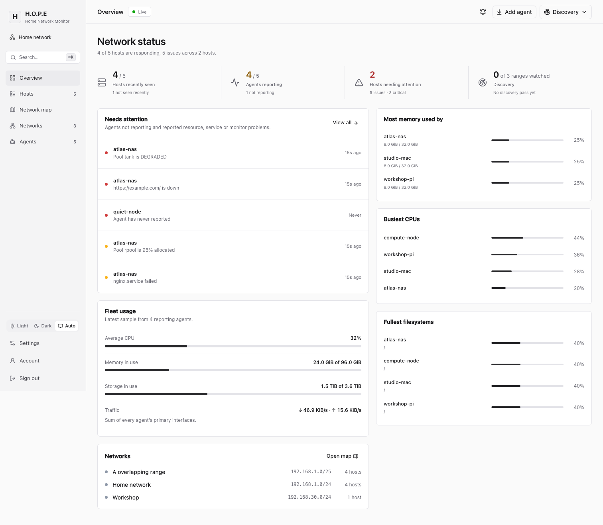
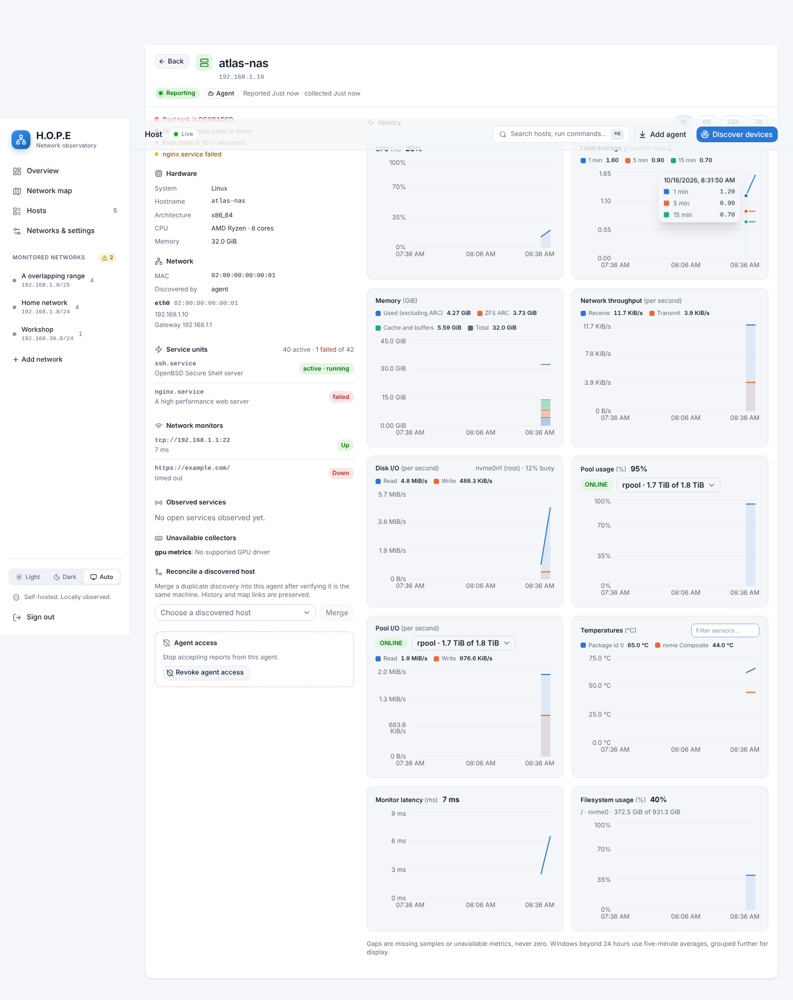
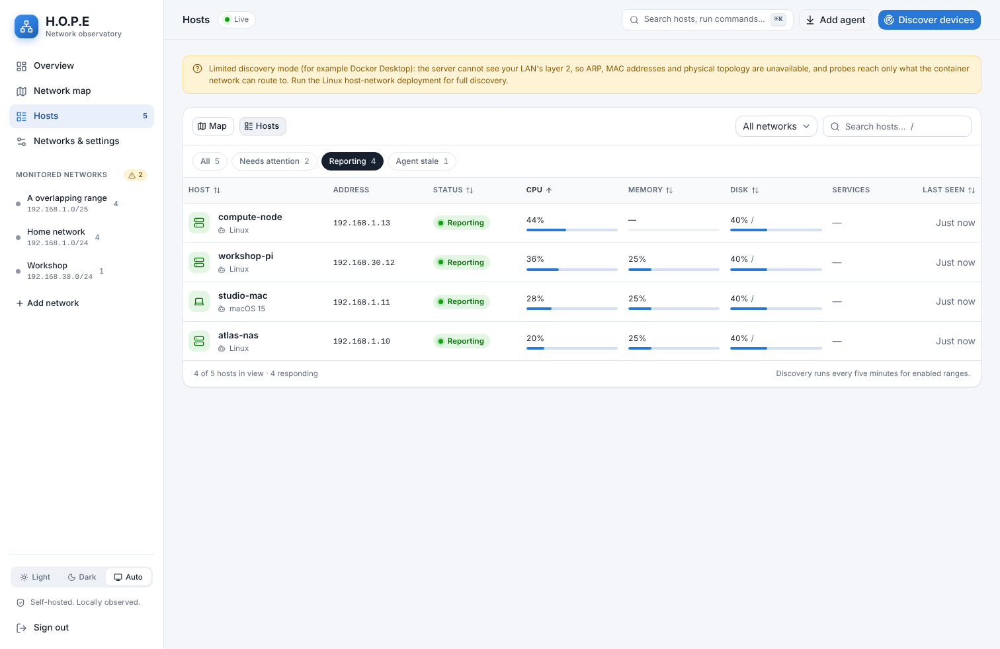
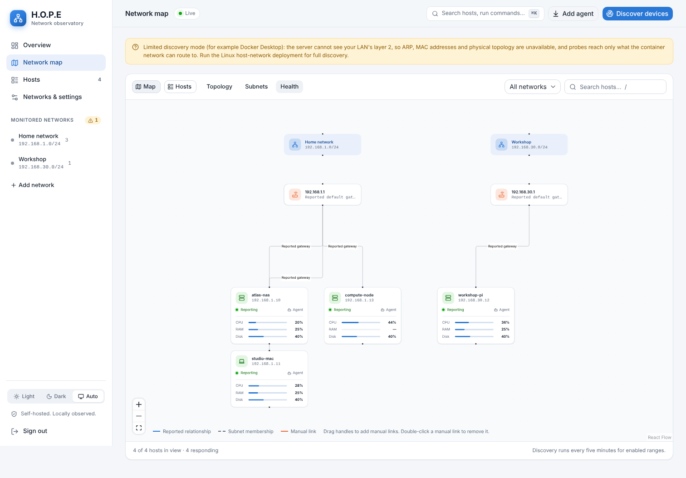
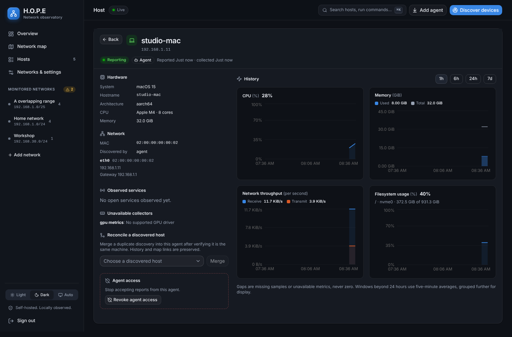
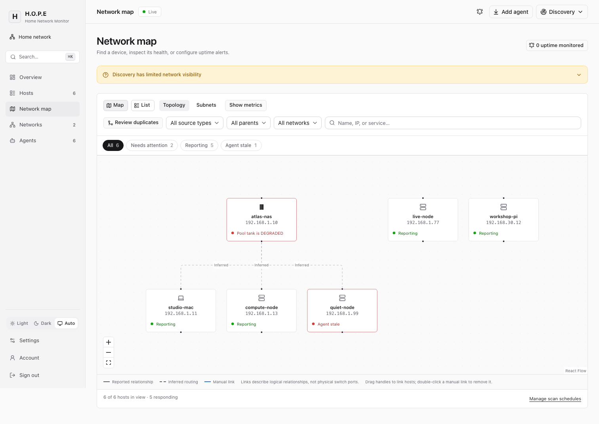
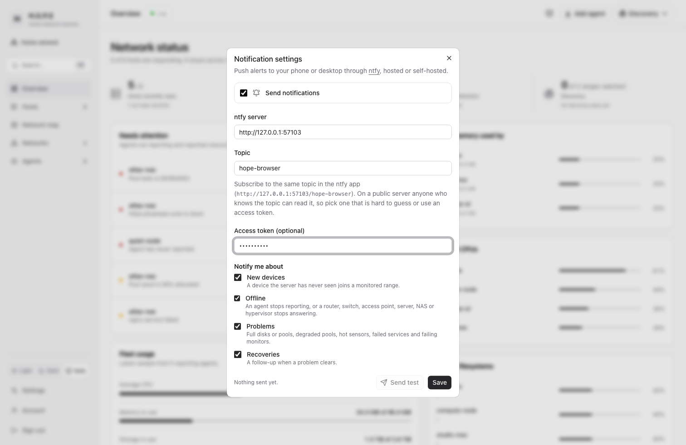

# H.O.P.E

Home network discovery, host monitoring and a lightweight reporting agent for up to 250 hosts, with a single administrator and one self-hosted Linux x86_64 server. The Linux x86_64 agent reports its machine's CPU, load, memory (including cache and ZFS ARC), network, storage, disk and pool throughput, temperatures, GPU, systemd units and reachability-monitor data to the server over HTTPS every 10 seconds by default (configurable from 5 to 60). The console updates live as reports arrive; system-service agents can be updated from the console through a root-owned updater that verifies releases against the key the host was installed with.

**Status: pre-release.** The code builds and passes its automated suites, but the release is **not** complete: key environment-dependent gates are unverified (below). Do not rely on it for anything that matters, and read [docs/validation.md](docs/validation.md) before trusting any claim made here.

## The console



- **Overview**: recently seen hosts, reporting agents, what needs attention (stale agents, CPU, memory or filesystems above 90%), fleet-wide usage, the busiest hosts and a getting-started checklist until the first agent reports. Devices not recently seen remain available in their own filter and do not count as an issue by themselves.
- **Hosts**: status filters, sortable columns and inline CPU, memory and disk meters; click a host for details.
- **Network map**: topology, subnet and health modes with provenance for reported, inferred and manual links, a minimap for large fleets, and drag-to-link.
- **Host details**: live usage tiles with sparklines, hardware, storage meters and ZFS pools, per-device throughput, temperature sensors, interfaces and counters, systemd units, network monitors, GPUs, and 1 h / 6 h / 24 h / 7 d history that draws outages as gaps. Open a host's full page for a two-column chart dashboard: CPU, load average, memory (used, ZFS ARC, cache and buffers under the total), bandwidth, disk I/O, pool usage and I/O, temperatures, monitor latency, filesystem and GPU usage.
- **Container history**: open a Docker container for CPU and memory charts over the same history windows. Container IDs keep recreated workloads separate; missing readings remain gaps, and stored history is still accessible when the container disappears from the latest report.
- **Command palette** (`⌘K` / `Ctrl+K`, or `/`): jump to any host or run any action from the keyboard.
- Light, dark and automatic themes; everything works at phone width.



| Hosts | Map (health mode) | Host details (dark) |
| --- | --- | --- |
|  |  |  |

| Router hierarchy (topology mode) | Notifications (ntfy) |
| --- | --- |
|  |  |

Screenshots are taken by the Playwright suite from synthetic inventory (`web/tests/console.spec.ts`).

## What is and is not in scope

In scope: discovery of IPv4 ranges (`/20` or smaller) with fair concurrent scanning, cancellation and progress, rescanned in the background on a gentle per-range schedule (every 5 minutes by default); a common-port scan, web-interface titles and mDNS/SSDP announcements for every device; device type guessing with the reasons shown (routers, Proxmox hosts, NAS boxes, phones, printers, cameras, robot vacuums, dishwashers and more) and a manual override; a router hierarchy from the default gateway and traceroutes; notifications through ntfy (new devices, offline agents and infrastructure, full disks, degraded pools, failed services, recoveries); map modes (topology, subnets, health) with provenance for observed, inferred and manual links (physical switch connections are never invented); Linux x86_64 server and agent builds; manual and SSH-assisted agent installation through one signed installer; history (raw 24 hours, five-minute aggregates through day seven); revocable per-agent credentials.

Not in scope and not planned for this release: Windows agents, distributed discovery, switch integrations (so which switch port or access point a device uses is not inferred), notification channels other than ntfy, multiple user accounts. Agents report only their own machine, never remote networks, and an unanswered probe does not prove a host is offline.

## Release gates: five product stages

| # | Stage | Evidence today | Still open |
| --- | --- | --- | --- |
| 1 | Discovery and hosts | Controlled two-range Docker fixtures (OrbStack, Linux ARM64): [routed](docs/benchmarks/discovery-routed.json) 25.4 s and [on-link](docs/benchmarks/discovery-on-link.json) 26.4 s for both ranges; fairness, cancellation and enrichment tests | A physical LAN with host networking and ARP; Docker Engine on a physical Linux host; Docker Desktop on Windows |
| 2 | Map modes and console | Playwright acceptance (17 Chromium tests) for the overview, topology/subnet/health modes, drag persistence, selection, filters, command palette, themes and range removal; screenshots reviewed | Tests use synthetic inventory, not data from real discovery |
| 3 | Agent and history | Agent fault tests, 250-host retention load test, a 30-minute [Linux x86_64 LXC measurement](docs/benchmarks/agent-linux-x86_64-lxc.json), and a 30-minute macOS arm64 measurement (see "Resource use") | Linux ARM64 and macOS x86_64 measurements; GPU-collector comparisons; the signed musl artifact was not re-measured |
| 4 | Manual installation | Transactional installer with rollback, covered by a 77-test harness with stubbed service managers and real signatures, **and a real Linux matrix (2026-10-15)**: Debian 13 with systemd, arm64 native and amd64 emulated, system and user services, custom CA; install, reinstall, interrupted activation, upgrade, downgrade refusal, uninstall, purge | **launchd (macOS) installation, upgrade, rollback and uninstall; the default public-CA path; physical x86_64 hardware and other Linux distributions** |
| 5 | SSH and release hardening | SSH jobs against an in-process SSH server and, since 2026-10-15, against a real OpenSSH 10.0 on Debian 13 (host-key binding, auth failures, user-service fallback, reinstall, dropped connection); a real Caddy 2.10.2 reverse proxy (SSE, Secure cookie, rate-limit key, spoofed `X-Forwarded-For`); Linux x86_64 signed release build and assembly with a throwaway key; CI definitions | The CI workflows have never run on GitHub; no production signing key exists; nginx and Traefik, `sudo` that needs a password |

Details, commands, dates and hashes: the "Release gate status" table in [docs/validation.md](docs/validation.md).

## Supported platforms

The current server and agent release target is Linux x86_64. The table records current release targets; historical checks on other platforms remain in the validation report.

| Component | Platform | Evidence |
| --- | --- | --- |
| Server | Linux x86_64 | Current release target |
| Agent | Linux x86_64 | Current release target; Debian 13 LXC measurement and systemd installer checks are documented in the fixture matrix |
| Agent installation | Linux x86_64, systemd, system and user mode, custom CA | The 2026-10-15 Debian 13 matrix passed for v0.1.1 artifacts; x86_64 ran under emulation, and the current-source rerun remains open |

## Install in one command

**Proxmox VE** (a Debian LXC container, built by the [community-scripts](https://github.com/community-scripts/ProxmoxVE) engine with its usual default/advanced settings; `update` inside the container installs the newest build, exactly as it does for any community script; 1 core, 512 MB RAM, 4 GB disk):

```sh
bash -c "$(curl -fsSL https://raw.githubusercontent.com/doomedramen/hope/main/ct/hope.sh)"
```

**Any other systemd Linux host** (a dedicated account, a hardened service with `CAP_NET_RAW` for discovery, and Caddy as the HTTPS reverse proxy with automatic public certificates or an internal CA for LAN names whose root is exported for agents; re-run to upgrade):

```sh
bash -c "$(curl -fsSL https://raw.githubusercontent.com/doomedramen/hope/main/scripts/install-hope.sh)"
```

The Proxmox pair (`ct/hope.sh`, `install/hope-install.sh`, `json/hope.json`) follows the community-scripts work instructions to the letter so it can be submitted to DevScripts unchanged; the host script uses the latest GitHub release when one is published and otherwise builds from source. Details, environment variables and what has and has not been verified: [docs/operations.md](docs/operations.md#one-command-installer).

## Quick start (Docker, Linux host networking)

```sh
# from a checkout of this repository
cp .env.example .env              # set HOPE_SERVER_URL to your public https:// origin
docker compose up -d --build      # host networking, NET_RAW only, read-only root
docker compose logs hope | grep 'setup token'
```

The Docker workflow is configured to publish Linux x86_64 images on pushes to `main` and version tags, with build-provenance attestations and an SBOM. It has not yet completed a successful GitHub run, so GHCR tags and attestations are not verified. After publication is verified, you can use `docker compose pull`; until then, build from the checkout as shown above.

Put an HTTPS reverse proxy in front of `HOPE_BIND` (default `127.0.0.1:8080`), open the canonical URL, and finish setup with the printed token and a password. Agents and the installer require HTTPS; a private CA is supported ([operations](docs/operations.md#custom-ca-server-agent-and-ssh-destination)). Caddy 2.10.2 has been tested in front of it (see the gate fixture); nginx and Traefik have not.

**Docker Desktop (macOS, Windows) cannot do layer-2 discovery.** `compose.desktop.yaml` runs in limited mode (no ARP, MAC addresses or physical topology; the console shows this limitation) and binds `127.0.0.1:8080`. Use it to try the console, not to map a LAN.

Agent installation needs a signed release published to `./releases` first ([Signed agent releases](docs/operations.md#signed-agent-releases)); until you publish one, the console shows that no release is available.

## Build from source

Requirements: Rust 1.96 (edition 2024), Node 26 with npm, and for the installer/release tests Python 3 and OpenSSL; ShellCheck is used for shell linting.

Install the project Git hooks once after installing web dependencies. Pre-commit checks Rust formatting and web formatting/lint; pre-push runs native and Linux workspace tests/lint, generated-protocol validation, shell and installer/release tests, and the web production build plus browser tests. Linux Rust and installer/release checks require a running Docker-compatible engine (Docker Desktop or OrbStack on macOS); they fail rather than silently skipping when it is unavailable. Install Chromium once with `cd web && npx playwright install chromium`. Privileged discovery/systemd fixtures and release build matrices remain outside pre-push.

```sh
make types                          # regenerate web/lib/protocol.ts from the Rust protocol (never overlap with a web build)
npm --prefix web ci
npm --prefix web run hooks:install  # Lefthook: pre-commit and pre-push
cargo build --release --locked --workspace
npm --prefix web run build             # static export in web/out
HOPE_SERVER_URL=http://localhost:8080 target/release/hope-server
```

Checks (the full release sequence is in [docs/IMPLEMENTATION_HANDOFF.md](docs/IMPLEMENTATION_HANDOFF.md)):

```sh
cargo fmt --all -- --check
cargo clippy --workspace --all-targets --all-features -- -D warnings
cargo test --workspace --locked
make installer-tests release-tests shell-checks
make linux-checks script-checks protocol-check browser-checks
tests/gates/run.sh all      # real systemd/sshd/Caddy gate fixture in disposable Docker containers (tests/gates/README.md)
python3 -I -m unittest discover -s tests/docs
npm --prefix web run typecheck && npm --prefix web run lint && npm --prefix web run test:e2e
```

The browser suite downloads its own Chromium; on a machine that already has one (or cannot download), point `PLAYWRIGHT_CHROMIUM` at the binary.

## Resource use of the agent

Targets: below 30 MB resident memory and below 0.5% of one core on average during normal reporting. Results are published only with their evidence file; reproduce with `scripts/bench-agent.sh` (60 s warmup, 1800 s measurement, a server outage phase). Results for the machines measured so far are in [docs/benchmarks/](docs/benchmarks/) and summarised in [docs/validation.md](docs/validation.md#agent-resource-benchmarks-ticket-11).

## Documentation

- [docs/architecture.md](docs/architecture.md): components, data flow, identity reconciliation, security model.
- [docs/operations.md](docs/operations.md): installation, reverse proxy, first-run setup, custom CA, discovery behaviour and probe traffic, agent install/upgrade/rollback/uninstall, revocation, backup/restore, release signing, troubleshooting by error code.
- [docs/validation.md](docs/validation.md): commands, environments, dates, hashes and results; the release gate table; every unverified item.
- [docs/IMPLEMENTATION_HANDOFF.md](docs/IMPLEMENTATION_HANDOFF.md): scope decisions and per-ticket implementation notes.

## License

MIT. See [LICENSE](LICENSE); the workspace `Cargo.toml` declares the same.

Host and container application icons are matched against the [selfh.st/icons catalog](https://cdn.jsdelivr.net/gh/selfhst/icons@main/index.json)
and served under the [CC BY 4.0 license](https://creativecommons.org/licenses/by/4.0/).
Device fingerprint artwork is matched against [Ubiquiti's device catalog](https://static.ui.com/fingerprint/0/devicelist.json)
and served from its `static.ui.com` CDN. Refresh the checked-in matching data with
`python3 scripts/update-icon-catalogs.py`.

### Uptime monitoring

Open a device's **Settings → Uptime monitoring** to opt in. Enable device downtime,
enter specific TCP ports, or use both. Monitoring is disabled by default for every device.
Configure and enable the existing **Notifications** ntfy connector to receive alerts.
Uptime alerts use the per-device selection independently of the connector's legacy
Offline and Resource categories; the connector's recovery setting still applies.

Checks run roughly once per minute and require two consecutive failures before an
alert opens. TCP checks connect from the server to the device's known IP addresses;
any successful connection makes that port healthy. These check TCP availability,
not HTTP responses or application health. Up to 32 ports can be selected per device.

Device downtime uses an agent's reports (stale after two minutes), or completed
scans of enabled discovery ranges. Discovered devices must be unseen for at least
two scan intervals and 15 minutes before they count as down. No completed scan
means no evidence of downtime. Enable an appropriate discovery range for devices
without agents. A recovery sends one follow-up when enabled; changing or disabling
monitoring clears its previous alerts silently. Existing general notification rules
remain available for devices without uptime monitoring.
